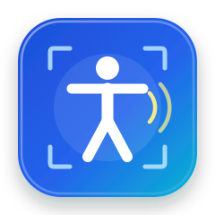
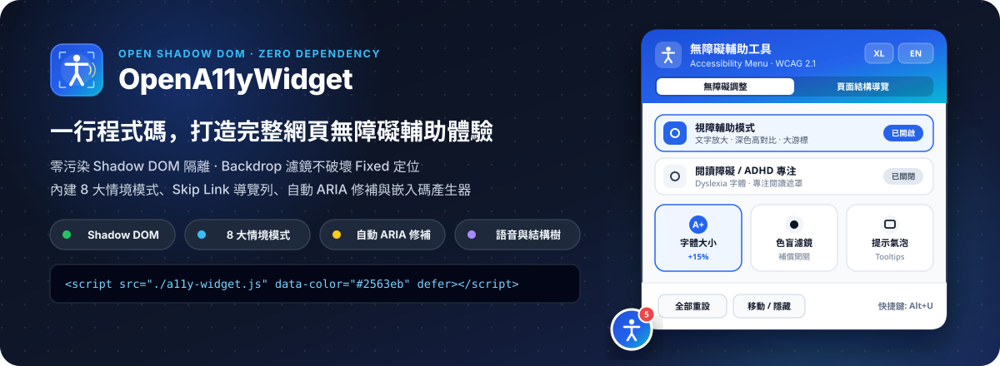

<div align="center">

<br />



# OpenA11yWidget

**純原生 Vanilla JS · 零依賴 · Open Shadow DOM 隔離的網頁無障礙輔助小工具**

[](#)
[](#)
[](#)
[](#)



</div>

---

## 專案簡介

**OpenA11yWidget** 是一套專為現代網站設計的單檔獨立網頁無障礙輔助工具。任何網站僅需引入一行 `<script>`，即可為訪客提供 **8 種情境快速模式**、**18 項視覺與閱讀調整功能**、**頁面結構樹導覽**、**原生 Skip-to-Content 快捷列** 與 **即時基礎 ARIA 補強**，所有介面與視覺遮罩皆封裝於獨立的 Open Shadow DOM 中，不污染宿主網站樣式與效能。

> [!IMPORTANT]
> **合規與檢定免責聲明（Compliance Disclaimer）**
>
> OpenA11yWidget 為前端輔助增強工具，旨在為終端使用者提供個人化的閱讀、視覺與導覽調整選項，**並不保證安裝本工具後即可通過 WCAG 2.1 / 2.2、ADA、Section 508 或台灣「無障礙網頁開發規範」之人工與自動化無障礙標章檢定**。
>
> 要符合各類無障礙檢定標準，網站仍須於原始碼層級確保語意化 HTML、足夠的色彩對比、完整的替代文字、表單標籤與原生鍵盤操作流程。本工具僅作為體驗增強，不可替代原生無障礙開發。

---

## 核心功能

| 模組 | 支援項目 |
| --- | --- |
| **情境快速模式 (8 種)** | 視障輔助、色盲友善、閱讀障礙友善、ADHD 專注、長者友善、肢體 / 鍵盤輔助、認知與學習輔助、防癲癇模式 |
| **視覺與色彩** | 深色高對比 / 淺色高對比 / 色彩反相、飽和度調整（高 / 低 / 全灰階）、SVG `<feColorMatrix>` 色盲補償濾鏡（綠 / 紅 / 藍黃色盲） |
| **文字與排版** | 等比字體縮放（+15% / +30% / +45%）、行高調整、字距與詞距調整、高易讀黑體 / 閱讀障礙字體 (Dyslexia)、文字對齊 |
| **導航與閱讀輔助** | 黑白特大游標、跟隨指標之閱讀尺規與專注遮罩、醒目連結、醒目標題、鍵盤焦點強化、懸停 / 焦點提示氣泡 (Tooltips) |
| **動態抑制與語音** | 暫停 CSS 動畫與 `<video>` 播放、視覺隱藏圖片並顯示 `alt` 替代文字框、點擊文字語音朗讀 (`window.speechSynthesis`) 與語速控制 |
| **頁面結構導覽** | 自動掃描頁面 `H1`–`H6` 標題樹、語意地標 (Landmarks) 與可見連結清單，支援點擊平滑跳轉與聚焦高亮 |
| **體驗與偏好記憶** | 超大面板模式 (XL)、終端使用者左右側移動與暫時隱藏（按 `Alt+U` 喚回）、繁中 / 英文雙語切換、`localStorage` 自動記憶 |

---

## 技術設計亮點

- **Open Shadow DOM 樣式隔離**：小工具介面、閱讀尺規、專注遮罩與提示氣泡皆封裝於 `#a11y-widget-host` ShadowRoot 內，確保與宿主網站 CSS 雙向零污染。
- **不破壞宿主 `position: fixed` 佈局**：色彩反相、飽和度與全灰階改透過 Shadow DOM 內的 `backdrop-filter` 疊層實現，避免在宿主容器套用 `filter` 而導致網站原本的 `fixed` / `sticky` 導覽列失效。
- **鍵盤導覽與焦點防護**：面板收合時啟用原生 `inert` 與 `aria-hidden="true"` 防止鍵盤誤入；開啟時提供 Focus Trap 循環聚焦與 `Escape` 歸還焦點；並於 `<body>` 頂端掛載原生 `#a11y-skip-host` 快速跳轉列。
- **SPA 動態監聽與基礎 ARIA 補強**：透過防抖 `MutationObserver` 持續偵測動態載入內容，自動維持字體縮放與圖片 `alt`、表單 `aria-label`、外連 `target="_blank"` 之基礎補強，並透過 `aria-live="polite"` 向螢幕報讀器播報狀態變更。
- **列印樣式隔離**：所有視覺覆寫包覆於 `@media screen` 內，並於 `@media print` 自動隱藏輔助工具與濾鏡層，不影響紙本列印排版。
- **100% 純本地零外部連線**：所有邏輯與偏好設定皆於瀏覽器端執行，不回傳任何頁面內容或訪客資料。

---

## 快速開始

### 方式一：透過 CDN 引入（jsDelivr）

在網頁的 `<head>` 或 `</body>` 前加入以下 `<script>` 標籤（可依需要調整 `@v1.0.0` 版本號）：

```html
<script
  src="https://cdn.jsdelivr.net/gh/ADT109119/OpenA11yWidget@v1.0.0/a11y-widget.js"
  data-color="#2563eb"
  data-position="bottom-right"
  data-size="md"
  data-shape="circle"
  data-lang="zh-TW"
  data-shortcut="Alt+U"
  defer>
</script>
```

### 方式二：自行託管單檔

下載 `a11y-widget.js` 至專案靜態資源目錄並直接引入：

```html
<script src="./a11y-widget.js" defer></script>
```

### 方式三：透過全域物件 `window.A11yWidgetConfig` 配置

```html
<script>
  window.A11yWidgetConfig = {
    color: '#059669',
    position: 'bottom-left',
    size: 'md',
    shape: 'pill',
    icon: 'universal',
    offsetX: 24,
    offsetY: 24,
    lang: 'zh-TW',
    shortcut: 'Alt+U',
    modules: ['profiles', 'visual', 'typography', 'navigation', 'motion', 'structure']
  };
</script>
<script src="https://cdn.jsdelivr.net/gh/ADT109119/OpenA11yWidget@v1.0.0/a11y-widget.js" defer></script>
```

---

## 配置屬性與 JavaScript API

### `<script>` `data-*` 屬性

| 屬性 | JS 鍵名 | 預設值 | 說明 |
| --- | --- | --- | --- |
| `data-color` | `color` | `#2563eb` | 主題色 HEX 色碼（自動計算文字反白/反黑對比色） |
| `data-position` | `position` | `bottom-right` | `bottom-right` \| `bottom-left` \| `top-right` \| `top-left` \| `middle-right` \| `middle-left` |
| `data-size` | `size` | `md` | 觸發按鈕尺寸：`sm` (46px) \| `md` (54px) \| `lg` (64px) |
| `data-shape` | `shape` | `circle` | `circle` (圓形純圖示) \| `pill` (膠囊圖示＋文字) |
| `data-icon` | `icon` | `universal` | `universal` (通用人形) \| `eye` (視覺) \| `sliders` (控制滑桿) |
| `data-offset-x` | `offsetX` | `24` | 水平邊距 (`0`–`120` px) |
| `data-offset-y` | `offsetY` | `24` | 垂直邊距 (`0`–`120` px) |
| `data-lang` | `lang` | `zh-TW` | 預設語言：`zh-TW` \| `en` |
| `data-shortcut` | `shortcut` | `Alt+U` | 快捷開關面板組合鍵 |
| `data-modules` | `modules` | 全部啟用 | 逗號分隔啟用模組：`profiles,visual,typography,navigation,motion,structure` |

### `window.A11yWidget` 公開方法

```js
window.A11yWidget.open();                              // 開啟面板
window.A11yWidget.close();                             // 關閉面板
window.A11yWidget.toggle();                            // 切換開關
window.A11yWidget.applyProfile('dyslexia-friendly');   // 一鍵套用情境模式
window.A11yWidget.setState({ fontSize: 2 });           // 批次調整特定功能狀態
window.A11yWidget.getState();                          // 取得目前無障礙狀態
window.A11yWidget.updateConfig({ color: '#7c3aed' });  // 動態更新外觀配置
window.A11yWidget.getRemediationStats();               // 取得即時 ARIA 補強統計
window.A11yWidget.reset();                             // 重設所有輔助設定
```
